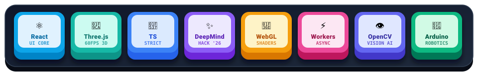
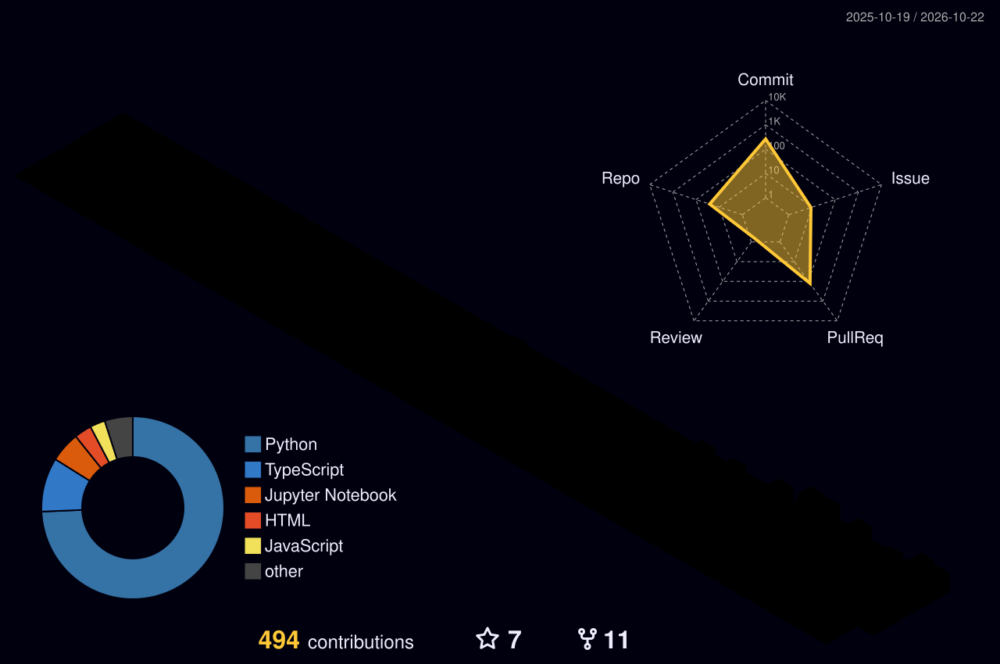

<div align="center">

  <!-- 1. 깔끔한 웨이빙 헤더 배너 -->
  

  <!-- 2. 시그니처 기하학 & 천문학 엠블럼 & 타이틀 -->
  <a href="https://strongsun806.github.io/hyegang-portfolio/" target="_blank">
    
  </a>

  <h2>🪐 권혜강 (Hyegang Kwon)</h2>

  <!-- 실시간 타이핑 애니메이션 -->
  <a href="https://strongsun806.github.io/hyegang-portfolio/" target="_blank">
    
  </a>

  <!-- 3D 입체 글로시(Plastic) 키워드 뱃지 -->
  <p>
    <a href="https://strongsun806.github.io/hyegang-portfolio/#hackathon" target="_blank">
      
    </a>
    <a href="https://strongsun806.github.io/hyegang-portfolio/#projects" target="_blank">
      
    </a>
    <a href="https://strongsun806.github.io/hyegang-portfolio/" target="_blank">
      
    </a>
  </p>

  <!-- 소셜 & 포트폴리오 링크 -->
  <p>
    <a href="https://strongsun806.github.io/hyegang-portfolio/" target="_blank">
      
    </a>
    <a href="https://github.com/strongsun806" target="_blank">
      
    </a>
    <a href="https://instagram.com/strong._.sun" target="_blank">
      
    </a>
    <a href="mailto:khg010806@gmail.com">
      
    </a>
  </p>

  <br/>

  ---

  <br/>

  <!-- 3. 3D 아이소메트릭 플로팅 코어 카드 (DeepMind 해커톤 & 3D 웹 & 핀테크/AI) -->
  <h2>🧊 3D Core Pillars</h2>

  <a href="https://strongsun806.github.io/hyegang-portfolio/" target="_blank">
    
  </a>

  <br/><br/>

  <!-- 4. 귀여운 3D 입체 키캡 & 스쿼클 스킬셋 (Cute 3D Keycaps & Toolbox) -->
  <h2>🎹 3D Tactile Skill Deck</h2>
  <p><sub>입체감 있게 반응하는 3D 기하학 키캡과 카테고리별 핵심 기술 스택이에요 ✨</sub></p>

  

  <br/><br/>

  <table width="100%">
    <tr>
      <td width="33%" align="center" valign="top">
        <br/>
        <b>🎨 Frontend &amp; 3D Spatial</b>
        <br/><br/>
        <p>
          
        </p>
        <p>
          <code>React</code> <code>TypeScript</code> <code>Three.js</code><br/>
          <code>R3F</code> <code>Tailwind</code> <code>Canvas 2D</code>
        </p>
      </td>
      <td width="33%" align="center" valign="top">
        <br/>
        <b>🧠 AI, Vision &amp; Embedded</b>
        <br/><br/>
        <p>
          
        </p>
        <p>
          <code>LangGraph</code> <code>ChromaDB (RAG)</code> <code>Gemini API</code><br/>
          <code>Python</code> <code>OpenCV</code> <code>Scikit-Learn</code>
        </p>
      </td>
      <td width="34%" align="center" valign="top">
        <br/>
        <b>⚙️ Architecture &amp; Tools</b>
        <br/><br/>
        <p>
          
        </p>
        <p>
          <code>Web Workers</code> <code>WebSocket</code><br/>
          <code>Rule Engine</code> <code>Git</code> <code>GitHub Pages</code>
        </p>
      </td>
    </tr>
  </table>

  <br/>

  <!-- 5. 대표 하이라이트 & 프로젝트 (깔끔한 2x3 카드) -->
  <h2>🚀 Featured Highlights</h2>

  <table width="100%">
    <tr>
      <td width="50%" valign="top">
        <h3 align="center">✨ 2026 Google DeepMind AI Hackathon</h3>
        <p align="center">
          
          
          
        </p>
        <p align="left">
          <b><a href="https://github.com/strongsun806/GDM_HACK1">🛡️ SafeCity AI (Track 3: AI for Social Good)</a></b><br/>
          극한호우·지하철 침수 재난 시 <code>Gemini 4 Argon</code>의 1M 컨텍스트(역사 CAD 도면 + 기상 레이더 + 24개 IoT 수위 센서)와 <code>Companion Safety Verifier Loop</code>를 결합해 일반 승객과 교통약자(방수 엘리베이터 #3) 맞춤형 3D 대피 경로 및 4개국어 음성 안내를 제공하는 실시간 3D 디지털 트윈 관제 시스템입니다.
        </p>
      </td>
      <td width="50%" valign="top">
        <h3 align="center">🔷 FINDER</h3>
        <p align="center">
          
          
          
        </p>
        <p align="left">
          <b>Digital Twin 3D Monitoring Platform</b><br/>
          대규모 공간 인프라 및 1,400+ 센서 노드를 실시간 3D로 가상화한 관제 플랫폼입니다. <code>InstancedMesh</code> 배칭과 백그라운드 스레드 분리로 끊김 없는 60 FPS를 유지합니다.
        </p>
      </td>
    </tr>
    <tr>
      <td width="50%" valign="top">
        <h3 align="center">✈️ TripPilot</h3>
        <p align="center">
          <a href="https://trippilothyegang.streamlit.app/" target="_blank">
            
          </a>
          
          
        </p>
        <p align="left">
          <b><a href="https://github.com/strongsun806/TripPilot">Intelligent Multi-Hop Travel Copilot</a></b><br/>
          3D 비행 마스코트 '파일럿 토리'와 함께하는 2-Pass LangGraph RAG 기반 글로벌 여행 플래너입니다. 59개 글로벌 도시 실사 뷰파인더, 무중단 백그라운드 추론, 일자별 분할 동선 지도 및 한글 PDF 가이드북 리포트 자동 생성을 지원합니다.
        </p>
      </td>
      <td width="50%" valign="top">
        <h3 align="center">⚡ Volt-Spec</h3>
        <p align="center">
          
          
          
        </p>
        <p align="left">
          <b><a href="https://github.com/strongsun806/voltspec">EV &amp; Battery Engineering RAG Console</a></b><br/>
          국내외 100종 양산 전기차 제원과 위키백과 문서를 결합한 고전압 배터리 지식 서비스입니다. 엄격한 <code>[근거 N]</code> 인용 엔진, 3단 심층 기술 리포트 생성 및 허위 기술 주장 팩트체크 시스템을 탑재했습니다.
        </p>
      </td>
    </tr>
    <tr>
      <td width="50%" valign="top">
        <h3 align="center">⚓ Port Scrap</h3>
        <p align="center">
          
          
          
        </p>
        <p align="left">
          <b>Port Logistics Fintech Platform</b><br/>
          부산항 등 터미널-포워더 간 복잡한 항만물류비 정산을 자동화하고, <code>ISO 6346</code> 컨테이너 체크디지트 검증으로 정산 오차를 원천 방지하는 핀테크 콘솔입니다.
        </p>
      </td>
      <td width="50%" valign="top">
        <h3 align="center">🎓 AI &amp; Robotics Mentorship</h3>
        <p align="center">
          
          
          
        </p>
        <p align="left">
          <b>Hands-on Tech Instructor &amp; Mentor</b><br/>
          대학생 비전 AI 파이프라인 코칭 및 도원고(전자의수 제작), 문경여고, 용마고 등 고등학교 피지컬 컴퓨팅 출강을 통해 실전 기술을 나누고 있습니다.
        </p>
      </td>
    </tr>
  </table>

  <br/>

  <br/>

  <!-- 6. 보이는 실험실: 기하학 & 쉐이더 관측소 (Visual R&D Lab) -->
  <h2>🧪 Visual R&D Lab: Geometric &amp; Shader Observatory</h2>
  <p><sub>수학적 기하학(Geometry)과 WebGL/GLSL 쉐이더 연산을 시각화하는 권혜강의 실시간 공간 웹 실험실이에요 🔭</sub></p>

  <a href="https://strongsun806.github.io/hyegang-portfolio/" target="_blank">
    
  </a>

  <br/><br/>

  <table width="100%">
    <tr>
      <td width="50%" valign="top">
        <h3 align="center">🪐 Lab 01: Keplerian Orbit &amp; N-Body</h3>
        <p align="center">
          
          
          
        </p>
        <p align="left">
          <b>Celestial Gravitational Field Simulator</b><br/>
          케플러 제1·2·3법칙과 다체 문제(N-body problem)의 중력 섭동 역학을 브라우저에서 계산합니다. 1,000+ 천체 궤도를 GPGPU 연산으로 오프스크린 계산하여 프레임 드랍 없는 궤적 렌더링을 구현합니다.
        </p>
      </td>
      <td width="50%" valign="top">
        <h3 align="center">💠 Lab 02: 4D Hypercube Projection</h3>
        <p align="center">
          
          
          
        </p>
        <p align="left">
          <b>SO(4) Non-Euclidean Wireframe Sandbox</b><br/>
          4차원 공간 회전군 $SO(4)$의 회전 행렬을 3차원 입체 공간으로 실시간 스테레오그래픽 투영(Stereographic Projection)하는 기하학적 시각화 엔진입니다. 16개 꼭짓점과 32개 모서리의 단면을 마우스로 탐색합니다.
        </p>
      </td>
    </tr>
    <tr>
      <td width="50%" valign="top">
        <h3 align="center">🌌 Lab 03: Raymarched Event Horizon</h3>
        <p align="center">
          
          
          
        </p>
        <p align="left">
          <b>Spacetime Gravitational Lensing Engine</b><br/>
          일반상대성이론의 슈바르츠실트 블랙홀 시공간 곡률을 단일 Fragment Shader 상에서 레이마칭(Raymarching) 기법으로 렌더링합니다. 배경 성단의 중력 렌즈 왜곡과 광자구(Photon Sphere)를 수치해석적으로 시뮬레이션합니다.
        </p>
      </td>
      <td width="50%" valign="top">
        <h3 align="center">🔊 Lab 04: Spatial Audio &amp; 10K Nebula</h3>
        <p align="center">
          
          
          
        </p>
        <p align="left">
          <b>3D Positional Sound &amp; Voxel Particle Galaxy</b><br/>
          브라우저의 Web Audio API <code>PannerNode</code>를 가상 3D 카메라 좌표계와 동기화하고, FFT 오디오 스펙트럼의 주파수 대역별 진폭에 따라 10,000개의 복셀 파티클 성운이 실시간으로 팽창·진동하는 인터랙티브 사운드스케이프입니다.
        </p>
      </td>
    </tr>
  </table>

  <br/>

  <!-- 7. 3D 공간 컴퓨팅 아키텍처 & 설계 철학 (Spatial Architecture Matrix) -->
  <h2>📐 Spatial Engineering &amp; Architecture Matrix</h2>
  <p><sub>타협 없는 프레임율과 견고한 시스템 설계를 위한 3대 핵심 엔지니어링 원칙이에요 🧊</sub></p>

  <table width="100%">
    <tr>
      <td width="33%" align="center" valign="top">
        <br/>
        <b>⚡ Zero-Stutter 60 FPS</b>
        <br/><br/>
        <p>
          
          
        </p>
        <p align="left">
          메인 UI 스레드와 3D 렌더링·계산 파이프라인을 완전히 분리합니다. 무거운 물리 및 기하 연산 중에도 16.6ms 프레임 예산을 엄수하여 끊김 없는 부드러움을 보장합니다.
        </p>
      </td>
      <td width="33%" align="center" valign="top">
        <br/>
        <b>🎯 1-Call Geometry Batching</b>
        <br/><br/>
        <p>
          
          
        </p>
        <p align="left">
          수천 개의 노드와 센서 객체를 단일 <code>InstancedMesh</code>와 동적 Matrix 버퍼로 병합합니다. GPU 드로우콜을 극소화하여 모바일 및 저사양 환경에서도 즉각 구동됩니다.
        </p>
      </td>
      <td width="34%" align="center" valign="top">
        <br/>
        <b>🛡️ Verifiable AI Safety Loop</b>
        <br/><br/>
        <p>
          
          
        </p>
        <p align="left">
          AI 에이전트의 생성 결과에 안전 검증 루프(Verifier Loop)와 규칙 엔진(Rule Engine)을 결합합니다. 재난 관제와 금융 정산 등 오차가 허용되지 않는 도메인에서 무결성을 증명합니다.
        </p>
      </td>
    </tr>
  </table>

  <br/>

  <!-- 8. 3D 입체 잔디 (3D Isometric Contribution Grass) & 활동 지표 -->
  <h2>🌱 3D Contribution Grass &amp; Telemetry</h2>
  <p><sub>실제 GitHub 커밋 데이터를 기반으로 입체 복셀(Voxel) 블록이 살아 움직이는 3D 잔디예요 🧊</sub></p>

  

  <br/><br/>

  <p>
    
    
  </p>

  <p>
    
  </p>

  <br/>

  <br/>

  <!-- 9. 2026 우주 탐구 궤도 & 로드맵 (Orbital Roadmap) -->
  <h2>🛰️ Orbital Roadmap: 2026 Exploration Trajectory</h2>
  <p><sub>디지털 공간과 인공지능의 지평을 넓혀가는 권혜강의 탐구 궤도예요 🌌</sub></p>

  <table width="100%">
    <tr>
      <td width="25%" align="left" valign="top">
        <b>🚀 Phase 01: Social Impact</b><br/>
        <small><code>Google DeepMind Hackathon</code></small>
        <ul>
          <li>SafeCity AI 3D 디지털 트윈 관제</li>
          <li>Gemini 4 Argon 멀티모달 긴급 대피 동선 최적화</li>
          <li>교통약자 안전 경로 검증 루프 구현</li>
        </ul>
      </td>
      <td width="25%" align="left" valign="top">
        <b>🪐 Phase 02: Spatial Compute</b><br/>
        <small><code>WebGPU &amp; Next-Gen Shaders</code></small>
        <ul>
          <li>WebGPU Compute Shader 파이프라인 R&amp;D</li>
          <li>10만 단위 N-Body 천체 중력장 시뮬레이션</li>
          <li>비유클리드 4D 공간 기하 투영 엔진 오픈소스화</li>
        </ul>
      </td>
      <td width="25%" align="left" valign="top">
        <b>🛰️ Phase 03: Autonomous Agents</b><br/>
        <small><code>Spatial Agentic Console</code></small>
        <ul>
          <li>3D 공간 인터랙션 기반 에이전트 인터페이스</li>
          <li>LangGraph 멀티 에이전트 실시간 협업 콘솔</li>
          <li>ChromaDB 대규모 지식 그래프 3D 시각화</li>
        </ul>
      </td>
      <td width="25%" align="left" valign="top">
        <b>🌌 Phase 04: Ecosystem &amp; Scale</b><br/>
        <small><code>Open Source &amp; Mentorship</code></small>
        <ul>
          <li>고성능 Spatial Web React 컴포넌트 덱 배포</li>
          <li>미래 세대를 위한 피지컬 컴퓨팅 멘토링 지속</li>
          <li>글로벌 테크 컨퍼런스 기여 및 기술 블로그 기고</li>
        </ul>
      </td>
    </tr>
  </table>

  <br/>

  <!-- 10. 기하학 & 천문학 마무리 시그니처 -->
  <h2>🌌 Celestial Observational Lounge</h2>

```text
       ✦        .        🪐       .       ✦        .       ✨
             .              *               .       *
       .       ┌───────⟡ Cosmic Coordinate ⟡───────┐       .
           *   │  "Optimizing Frames, Architecting Logic,  │   .
    ✨         │   and Navigating the Spatial Cosmos."     │         🪐
       .       └───────────────────────────────────┘       *
             *        .          ✦         .         *
"광활한 디지털 우주를 탐험하며, 언제나 흥미로운 기술 항해와 협업을 환영합니다 🌌🛰️"
```

  

</div>
