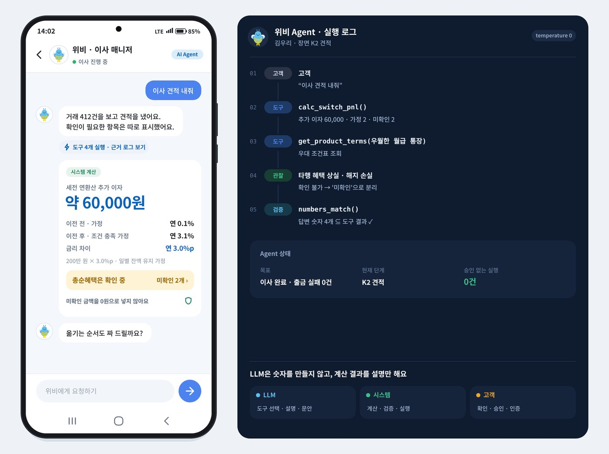
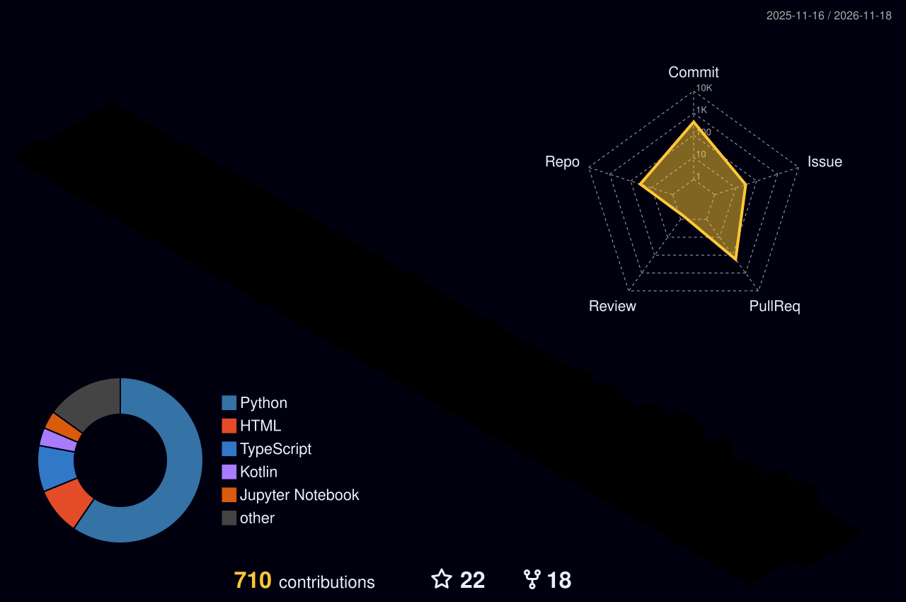

  <!-- 1. 깔끔한 웨이빙 헤더 배너 -->
  

  <!-- 2. 시그니처 기하학 & 천문학 엠블럼 & 타이틀 -->
  

  <h2>🪐 권혜강 (Hyegang Kwon)</h2>

  <!-- 실시간 타이핑 애니메이션 -->
  

  <!-- 3D 입체 글로시(Plastic) 키워드 뱃지 -->
  

    
    
    
  

  <!-- 소셜 & 포트폴리오 링크 -->
  

    
    
    
    
  

   

  ---

   

  <!-- 3. 기술 스택 -->
  <h2>🛠️ Tech Stack</h2>

  <table width="100%">
    <tr>
      <td width="33%" align="center" valign="top">
         
        <b>🎨 Frontend &amp; 3D Spatial</b>
          
        

          
        

        

          <code>React</code> <code>TypeScript</code> <code>Three.js</code> 
          <code>R3F</code> <code>Tailwind</code> <code>Canvas 2D</code>
        

      </td>
      <td width="33%" align="center" valign="top">
         
        <b>🧠 AI, Vision &amp; Embedded</b>
          
        

          
        

        

          <code>LangGraph</code> <code>ChromaDB (RAG)</code> <code>Gemini API</code> 
          <code>Python</code> <code>OpenCV</code> <code>Scikit-Learn</code>
        

      </td>
      <td width="34%" align="center" valign="top">
         
        <b>⚙️ Architecture &amp; Tools</b>
          
        

          
        

        

          <code>Web Workers</code> <code>WebSocket</code> 
          <code>Rule Engine</code> <code>Git</code> <code>GitHub Pages</code>
        

      </td>
    </tr>
  </table>

   

  <!-- 4. 대표 프로젝트 -->
  <h2>🚀 Featured Highlights</h2>

  <table width="100%">
    <tr>
      <td colspan="2" valign="top">
        <h3 align="center">🏆 2026 WOORI × SSAFY AI Agent 아이디어 경진대회 · 우수상</h3>
        

          
          
          
        

        

          
        

        

          <b><a href="https://github.com/strongsun806/WOORI_SSAFY_2026">🏦 WON이사 — AI 금융 이사 매니저</a></b> 
          주거래 은행 이동의 비용·혜택·시점을 견적으로 보여 주고, 자동이체·급여계좌 이전 계획부터 소비 분석·상품 추천·꿀머니 퀘스트로 정착까지 돕는 AI Agent입니다. <b>AI는 해석 · 시스템은 검증 · 고객은 승인</b> 원칙으로, 팀 자체 평가(qwen3:8b · 가상 데이터 · 3회 반복)에서 <code>승인 없는 실행 0건</code> · <code>이사 시나리오 21/21</code>을 기록했어요. 
          🙋‍♀️ My Role: 장면별 앱 목업 & Agent 실행 로그 데모 화면 설계·구현 · 시연 영상 · 결선 발표자료 제작
        

      </td>
    </tr>
    <tr>
      <td width="50%" valign="top">
        <h3 align="center">✨ 2026 Google DeepMind AI Hackathon</h3>
        

          
          
          
        

        

          <b><a href="https://github.com/strongsun806/GDM_HACK1">🛡️ SafeCity AI (Track 3: AI for Social Good)</a></b> 
          극한호우·지하철 침수 재난 시 <code>Gemini 4 Argon</code>의 1M 컨텍스트(역사 CAD 도면 + 기상 레이더 + 24개 IoT 수위 센서)와 <code>Companion Safety Verifier Loop</code>를 결합해 일반 승객과 교통약자(방수 엘리베이터 #3) 맞춤형 3D 대피 경로 및 4개국어 음성 안내를 제공하는 실시간 3D 디지털 트윈 관제 시스템입니다.
        

      </td>
      <td width="50%" valign="top">
        <h3 align="center">🔷 FINDER</h3>
        

          
          
          
        

        

          <b>Digital Twin 3D Monitoring Platform</b> 
          대규모 공간 인프라 및 1,400+ 센서 노드를 실시간 3D로 가상화한 관제 플랫폼입니다. <code>InstancedMesh</code> 배칭과 백그라운드 스레드 분리로 끊김 없는 60 FPS를 유지합니다.
        

      </td>
    </tr>
    <tr>
      <td width="50%" valign="top">
        <h3 align="center">✈️ TripPilot</h3>
        

          
          
          
        

        

          <b><a href="https://github.com/strongsun806/TripPilot">Intelligent Multi-Hop Travel Copilot</a></b> 
          3D 비행 마스코트 '파일럿 토리'와 함께하는 2-Pass LangGraph RAG 기반 글로벌 여행 플래너입니다. 59개 글로벌 도시 실사 뷰파인더, 무중단 백그라운드 추론, 일자별 분할 동선 지도 및 한글 PDF 가이드북 리포트 자동 생성을 지원합니다.
        

      </td>
      <td width="50%" valign="top">
        <h3 align="center">⚡ Volt-Spec</h3>
        

          
          
          
        

        

          <b><a href="https://github.com/strongsun806/voltspec">EV &amp; Battery Engineering RAG Console</a></b> 
          국내외 100종 양산 전기차 제원과 위키백과 문서를 결합한 고전압 배터리 지식 서비스입니다. 엄격한 <code>[근거 N]</code> 인용 엔진, 3단 심층 기술 리포트 생성 및 허위 기술 주장 팩트체크 시스템을 탑재했습니다.
        

      </td>
    </tr>
    <tr>
      <td width="50%" valign="top">
        <h3 align="center">⚓ Port Scrap</h3>
        

          
          
          
        

        

          <b>Port Logistics Fintech Platform</b> 
          부산항 등 터미널-포워더 간 복잡한 항만물류비 정산을 자동화하고, <code>ISO 6346</code> 컨테이너 체크디지트 검증으로 정산 오차를 원천 방지하는 핀테크 콘솔입니다.
        

      </td>
      <td width="50%" valign="top">
        <h3 align="center">🎓 AI &amp; Robotics Mentorship</h3>
        

          
          
          
        

        

          <b>Hands-on Tech Instructor &amp; Mentor</b> 
          대학생 비전 AI 파이프라인 코칭 및 도원고(전자의수 제작), 문경여고, 용마고 등 고등학교 피지컬 컴퓨팅 출강을 통해 실전 기술을 나누고 있습니다.
        

      </td>
    </tr>
  </table>

   

   

  <!-- 5. 수상 & 활동 -->
  <h2>🏆 Awards &amp; Activities</h2>

  <table>
    <tr><th>시기</th><th align="left">내용</th></tr>
    <tr><td><code>2026.11</code></td><td>🥈 <b>2026 WOORI × SSAFY 우리WON뱅킹 AI Agent 아이디어 경진대회 우수상</b> — <a href="https://github.com/strongsun806/WOORI_SSAFY_2026">WON이사</a> (Team WON주민)</td></tr>
    <tr><td><code>2026.02</code></td><td>✨ <b>2026 Google DeepMind AI Hackathon</b> 출품 — <a href="https://github.com/strongsun806/GDM_HACK1">SafeCity AI</a> (Track 3: AI for Social Good)</td></tr>
    <tr><td><code>2025</code></td><td>🥇 <b>2025 부산라이즈혁신원 광고 영상 숏폼 해커톤 대상</b></td></tr>
    <tr><td><code>2022.09</code></td><td>🧪 <b>2022 대구×청년 소셜리빙랩</b> 참여 — 코오더 팀, 배달비 부담 완화를 위한 묶음 배달서비스 앱 개발 (<a href="https://www.smnews.co.kr/default/index_view_page.php?idx=173636">최종공유회 기사</a>)</td></tr>
    <tr><td><code>Now</code></td><td>🎓 <b>SSAFY 16기</b> Python Track 수강 중</td></tr>
    <tr><td><code>Mentoring</code></td><td>🤖 도원고 · 문경여고 · 용마고 피지컬 컴퓨팅 출강, 대학생 비전 AI 코칭</td></tr>
  </table>

   

  <!-- 6. GitHub 활동 -->
  <h2>🌱 GitHub Activity</h2>

  

    

  

    
    
  

  

    
  

   

  

