<div align="center">

  <!-- 1. 커스텀 애니메이션 Spatial Web & AI HUD 히어로 배너 -->
  <a href="https://hyegang-portfolio.netlify.app" target="_blank">
    
  </a>

  <br/><br/>

  <!-- 2. 시그니처 캐릭터 마스코트 & 타이핑 인트로 -->
  <a href="https://hyegang-portfolio.netlify.app" target="_blank">
    
  </a>

  <h1>🍮 Hyegang Kwon (권혜강)</h1>

  <!-- 실시간 타이핑 SVG 서브타이틀 -->
  <a href="https://hyegang-portfolio.netlify.app" target="_blank">
    
  </a>

  <!-- 3. 실시간 링크 & 소셜 뱃지 -->
  <p>
    <a href="https://hyegang-portfolio.netlify.app" target="_blank">
      
    </a>
    <a href="https://github.com/strongsun806" target="_blank">
      
    </a>
    <a href="https://instagram.com/strong._.sun" target="_blank">
      
    </a>
    <a href="mailto:khg010806@gmail.com">
      
    </a>
  </p>

  <br/>

  <!-- 4. 스포트라이트 마일스톤: 2026 Google DeepMind AI Hackathon -->
  <h2>✨ Spotlight Milestone</h2>

  

  <br/><br/>

  ---

  <br/>

  <!-- 5. 엔지니어링 포커스 & 핵심 영역 (3대 코어 필러) -->
  <h2>⚡ Engineering Pillars</h2>

  <table width="100%">
    <tr>
      <td width="33%" valign="top">
        <h3>🌐 3D &amp; Spatial Web</h3>
        <ul>
          <li><b>Three.js &amp; WebGL</b>: <code>InstancedMesh</code> 배칭으로 Draw Call <b>95% 감축</b> &amp; <b>60 FPS</b> 방어</li>
          <li><b>Spatial Computing</b>: 1,400+ 센서 텔레메트리 3D 실시간 가상화 및 Raycasting 정밀 피킹</li>
          <li><b>Canvas 2D Physics</b>: N-Body 벡터 가속도 &amp; 실시간 위상(Topology) 메쉬 시뮬레이션</li>
        </ul>
      </td>
      <td width="33%" valign="top">
        <h3>🤖 Agentic &amp; Vision AI</h3>
        <ul>
          <li><b>Google DeepMind Hackathon '26</b>: 파운데이션 모델 &amp; 에이전틱 AI 기반 인터랙티브 프로덕트 빌딩</li>
          <li><b>Multimodal AI UX</b>: 추론 파이프라인 스트리밍 시각화 및 저지연 프론트엔드 상태 동기화</li>
          <li><b>Computer Vision &amp; Mentorship</b>: OpenCV 비전 파이프라인 코칭 &amp; 피지컬 컴퓨팅(전자의수 등) 멘토링</li>
        </ul>
      </td>
      <td width="34%" valign="top">
        <h3>🏗️ Resilient Architecture</h3>
        <ul>
          <li><b>Non-Blocking Thread</b>: <code>Web Workers</code> &amp; <code>WebSocket</code> 실시간 대용량 스트림 분리 설계</li>
          <li><b>Rule Engine &amp; Fintech</b>: 항만물류 정산 규칙 엔진 설계 &amp; <code>ISO 6346</code> 체크디지트 검증</li>
          <li><b>Design Engineering</b>: 마이크로 인터랙션과 엔지니어링 안정성을 결합한 고밀도 UI/UX</li>
        </ul>
      </td>
    </tr>
  </table>

  <br/>

  <!-- 6. 대표 프로젝트 쇼케이스 하이라이트 (2x2 그리드) -->
  <h2>🚀 Featured Showcase</h2>

  <table width="100%">
    <tr>
      <td width="50%" valign="top">
        <h3 align="center">✦ 2026 Google DeepMind AI Hackathon</h3>
        <p align="center">
          
          
          
        </p>
        <p align="left">
          • <b>2026 Google DeepMind AI Hackathon</b> 참여 및 AI 네이티브 프로덕트 엔지니어링<br/>
          • 멀티모달 추론 파이프라인과 실시간 인터랙티브 웹 인터페이스의 유기적 결합<br/>
          • 복잡한 AI 에이전트 상태를 직관적으로 제어·시각화하는 고성능 UX 설계
        </p>
      </td>
      <td width="50%" valign="top">
        <h3 align="center">🔷 FINDER — 3D Digital Twin</h3>
        <p align="center">
          
          
          
        </p>
        <p align="left">
          • 대규모 공간 인프라 및 <b>1,400+ 센서 노드</b> 실시간 가상화 3D 관제 플랫폼<br/>
          • <code>InstancedMesh</code> 렌더링 최적화로 Draw Call 95% 절감 및 60 FPS 유지<br/>
          • 메인 스레드 프리징을 원천 차단하는 Web Worker + WebSocket 백그라운드 연산 분리
        </p>
      </td>
    </tr>
    <tr>
      <td width="50%" valign="top">
        <h3 align="center">⚓ Port Scrap — Logistics Fintech</h3>
        <p align="center">
          
          
          
        </p>
        <p align="left">
          • 부산항 등 터미널-포워더 간 <b>항만물류비 정산 자동화</b> 및 핀테크 콘솔<br/>
          • 복잡한 할증/운임 조건을 처리하는 커스텀 정산 <b>Rule Engine</b> 아키텍처 설계<br/>
          • <code>ISO 6346</code> 컨테이너 체크디지트 실시간 검증으로 휴먼 에러 제로화
        </p>
      </td>
      <td width="50%" valign="top">
        <h3 align="center">🎓 AI &amp; Robotics Tech Mentorship</h3>
        <p align="center">
          
          
          
        </p>
        <p align="left">
          • 대학생 대상 <b>AI 컴퓨터 비전 파이프라인</b> 및 머신러닝 실습 코칭<br/>
          • 도원고(전자의수 제작) / 문경여고 / 용마고 등 고등학교 피지컬 컴퓨팅 출강<br/>
          • 하드웨어 센서 제어부터 소프트웨어 비전 모델까지 아우르는 올라운더 기술 전달
        </p>
      </td>
    </tr>
  </table>

  <br/>

  <!-- 7. 정돈된 기술 스택 (Tech Ecosystem) -->
  <h2>🛠️ Tech Ecosystem</h2>

  <p>
    
  </p>

  <table width="100%">
    <tr>
      <td align="center" width="33%">
        <b>🎨 Frontend &amp; Spatial 3D</b><br/><br/>
        
        
        
        
        
        
        
      </td>
      <td align="center" width="33%">
        <b>🧠 AI, Vision &amp; Embedded</b><br/><br/>
        
        
        
        
        
        
      </td>
      <td align="center" width="34%">
        <b>⚙️ Architecture &amp; DevOps</b><br/><br/>
        
        
        
        
        
        
      </td>
    </tr>
  </table>

  <br/>

  <!-- 8. 깃허브 통계 카드 (다크 & 시안 테마 통일) -->
  <h2>📊 Activity Telemetry</h2>

  <p>
    
    
  </p>

  <p>
    
  </p>

  <br/>

  <!-- 9. 폼폼푸린 데브 라운지 (인터랙티브 터미널 SVG + 시그니처) -->
  <h2>🍮 Pompompurin's Dev Lounge</h2>

  

```text
       (  /  \  )     ⚡ "Optimizing Frames, Architecting Logic,
      (  *´-`*  )        and Crafting Thoughtful Digital Universes."
      (  uu  uu )     
"방문해 주셔서 감사합니다! 흥미로운 협업이나 AI · 3D 웹 기술 이야기는 언제든 환영해요 🍮✨"
```

  <!-- 10. 하단 웨이빙 캡슐 푸터 -->
  

</div>
